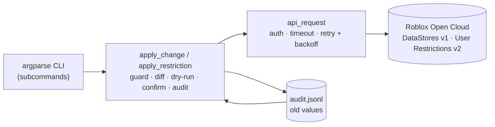

# ocops

A safety-first ops and moderation CLI for the [Roblox Open Cloud](https://create.roblox.com/docs/cloud) APIs. Inspect and edit DataStores, restore mistakes, and ban or unban players, with guardrails so a typo can't wipe live data.

> Not affiliated with Roblox. Use at your own risk, and try commands on a throwaway universe first.

## Why

General-purpose wrappers such as [`rbxcloud`](https://github.com/Sleitnick/rbxcloud) already cover the raw endpoints. `ocops` focuses on **safe operations**: every write shows old vs new, supports `--dry-run`, is logged with the previous value, and can be undone.

## Architecture



| Layer | Responsibility |
|---|---|
| CLI | Parse commands and flags; pick a profile (`test` default, `prod` opt-in) |
| Safety flow | Allowlist guard, protected users, diff, dry-run, prod confirmation, audit record |
| `api_request` | One place for auth header, timeouts, retries on `429`/`5xx`, and errors |
| `paginate` | Follows cursors/page tokens for both API versions |

## Quick start

Requires Python 3.9+ and Git.

```bash
git clone https://github.com/bss-k/ocops.git
cd ocops
python3 -m venv .venv && source .venv/bin/activate
pip install .
```

1. Create a **test experience** in Creator Hub (not your live game).
2. Create an API key (see [Key permissions](#key-permissions)) and put it in a `.env` (see [Configure](#configure)).
3. Try it:
   ```bash
   ocops datastores
   ocops set ocops_scratch player_1 '{"coins": 100}' --dry-run
   ```

### Development install

```bash
pip install -e ".[dev]"
pytest -v
```

## Configure

Create a `.env` in the folder you run `ocops` from (it is git-ignored):

```
TEST_API_KEY=...
TEST_UNIVERSE_ID=...
PROD_API_KEY=...
PROD_UNIVERSE_ID=...
PROTECTED_USER_IDS=111,222
```

Optional: set `OCOPS_SAFE_PREFIX` to change which DataStore names `ocops` may write to (default `ocops_`). Anything not starting with the prefix is refused.

Create API keys in Creator Hub with only the operations you need, scoped to one universe, with an expiry date. See [SECURITY.md](SECURITY.md).

### Key permissions

Add one API system per row to your key. Operation names in Creator Hub may be worded differently, so match them by what the command does.

| Commands | API system | What the key must allow |
|---|---|---|
| `datastores`, `keys` | DataStore | list DataStores, list entries |
| `get` | DataStore | read entry |
| `set`, `restore` | DataStore | read entry, create/update entry |
| `delete`, `restore` (undoing a create) | DataStore | read entry, delete entry |
| `bans` | User Restrictions | read |
| `ban`, `unban` | User Restrictions | read, write |

Use a separate key per profile, and start with read-only.

## Usage

```bash
ocops datastores
ocops keys ocops_scratch --limit 5
ocops get ocops_scratch player_1

ocops set ocops_scratch player_1 '{"coins": 100}' --dry-run
ocops set ocops_scratch player_1 '{"coins": 100}'
ocops restore ocops_scratch player_1        # undo using audit.jsonl
ocops delete ocops_scratch player_1

ocops ban 12345 --reason "exploiting" --hours 24
ocops unban 12345
ocops bans

ocops --profile prod set ocops_scratch player_1 '{"coins": 1}'   # asks you to type "prod"
```

`--profile` goes before the subcommand. Run `ocops -h` or `ocops <command> -h` for details.

## Safety features

- DataStore writes and deletes only work on names starting with `ocops_`
- `--dry-run` on every write
- `test` profile by default; `prod` requires typing a confirmation word
- Audit log with old values, and `restore` to undo
- Protected user IDs can't be banned
- Retries with exponential backoff, only for transient errors

## Tests

```bash
pytest -v
```

The suite mocks the HTTP layer, so no real keys or universes are touched.

## Metrics

Measure these from real use before publishing numbers (nothing here is estimated):

- [ ] Test count and coverage (`pytest --cov=ocops`)
- [ ] Time saved on one real task, e.g. a manual DataStore edit in Studio versus `ocops set`
- [ ] Number of real writes and restores recorded in `audit.jsonl`

## License

MIT, see [LICENSE](LICENSE).
